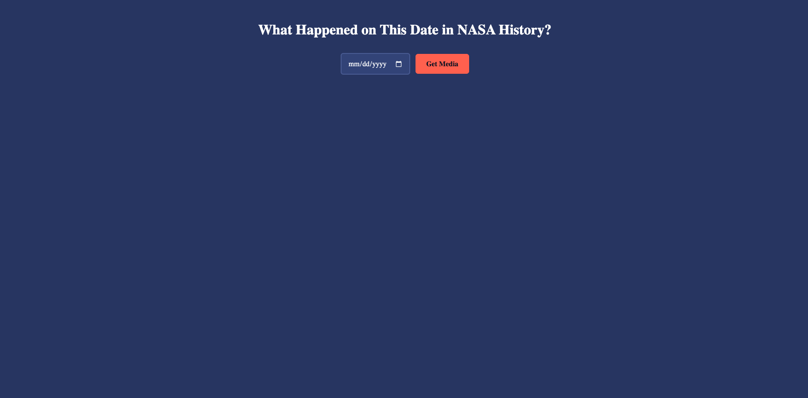
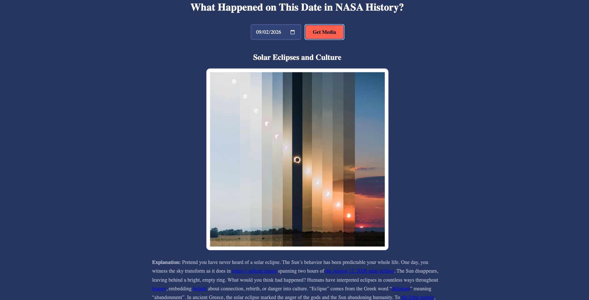

# 🚀 NASA History

A front-end app that shows NASA's picture (or video) of the day for any date you pick. Choose a date, click Get Media, and the page shows that day's title, image or video, and NASA's explanation.

[Visit NASA History](https://malcolmcpu.github.io/NASA-Simple/)

## Project Preview

## 🛠️ Built with

- HTML5
- CSS3
- JavaScript (vanilla ES6, using `fetch`)
- NASA's picture of the day data, through the `science.nasa.gov` API

## 🧭 How it works

1. You pick a date and click **Get Media**.
2. `main.js` reformats the date. The picker gives `2026-09-02`, and the API wants `260902`, so it removes the dashes and the first two digits of the year.
3. It sends a `fetch` request to `https://science.nasa.gov/wp-json/wp/v2/apod-basic/` followed by that date.
4. The response includes a title, a media type, and an explanation.
5. If the media type is an image, the page shows the high-resolution image. If it's a video, the script finds the video link inside the response's HTML and shows it in the video player.
6. The title and explanation are filled into the page.

## 📚 What I learned

- Fetching JSON from a public API with `fetch` and promises
- Showing and hiding elements depending on the data that comes back
- Parsing an HTML string from an API response with `DOMParser`
- Styling a page with a consistent color theme
